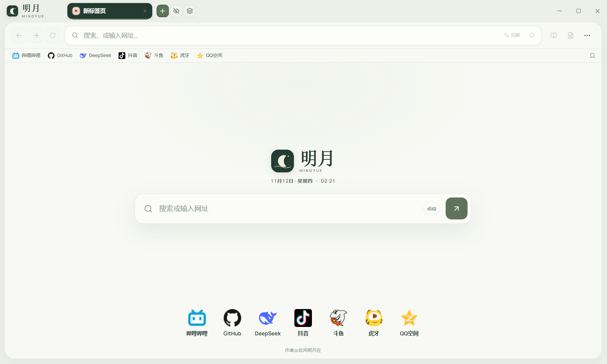
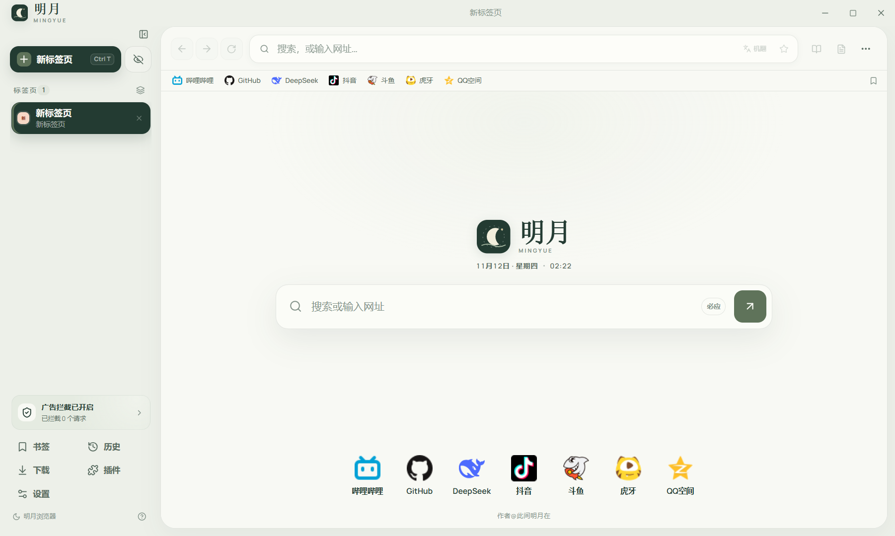
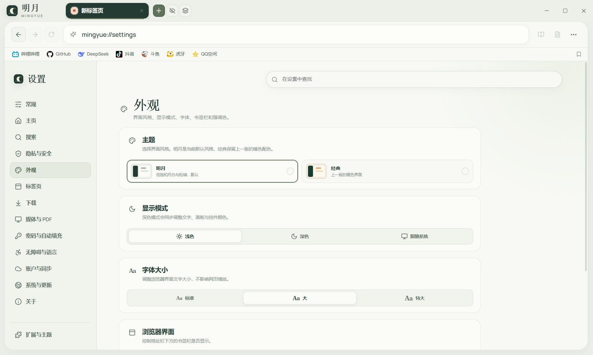
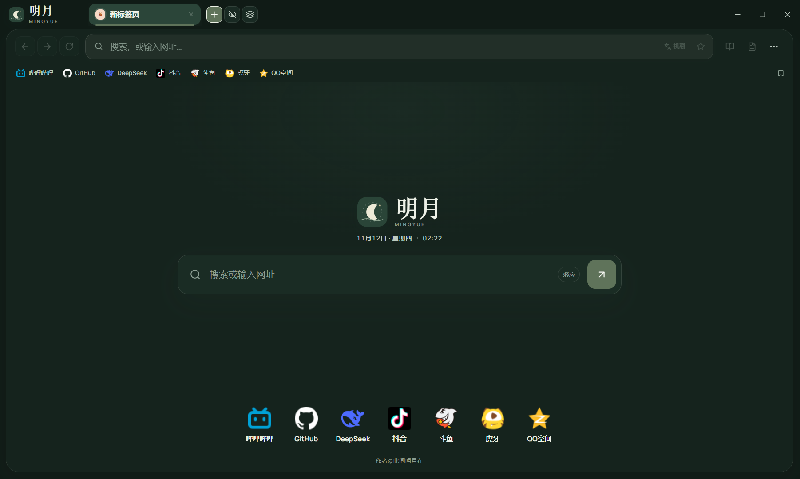
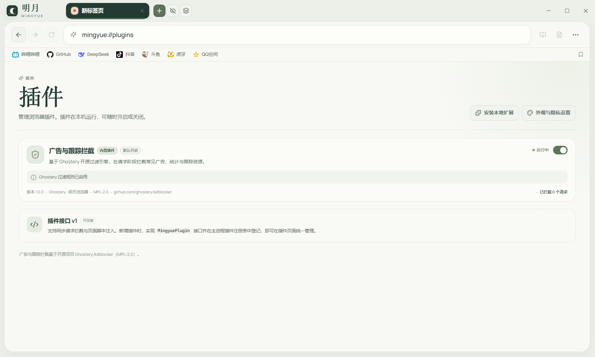
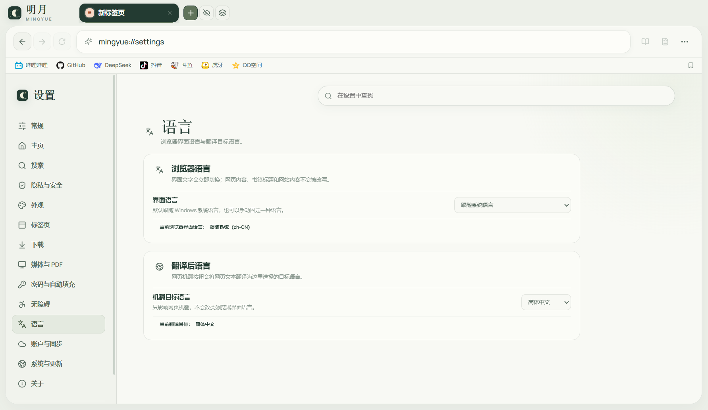

# 明月浏览器 · Mingyue Browser

一个自制、可真实上网的多标签桌面浏览器，使用 Electron + React + TypeScript 编写。界面以低饱和的月白、松绿和苔绿为主，起始页采用居中的品牌、日期时间与大搜索框，常用网站以图标和名称安静地收在底部，兼顾桌面、平板与手机宽度。

当前发布版本为 **v1.0.1**，同时提供可运行源码、Windows x64 便携版 exe 与 Android APK；窗口使用明月自绘标题栏与窗口控制按钮。

- GitHub：<https://github.com/mingyuezai0/mingyue-browser>
- Release：<https://github.com/mingyuezai0/mingyue-browser/releases/tag/v1.0.1>



## 设计

- **明月（默认）**：月白与雾绿底色、深松绿文字、苔绿强调色；起始页以留白、居中的品牌和大搜索框为主。
- **经典（可选）**：保留上一版暖米白、松绿与暖橙的界面语言，可在「设置 → 外观 → 界面风格」中切换。
- 支持「浅色 / 深色 / 跟随系统」三种显示模式。深色模式使用深松绿表面与暖白文字，并同步适配弹窗、菜单、输入框、插件页与设置页。
- 字号提供「标准 / 大 / 特大」三档，默认为大；界面以 CSS 字号倍率统一缩放，网页内容仍使用独立的页面缩放。
- 中文标题使用宋体基因的展示字体，数字与英文使用 Fraunces，界面文字使用 Manrope 与系统中文字体。
- 桌面端提供两种布局：**顶部栏**（默认，标签横排在窗口顶部）与**侧边栏**（标签竖排在左侧）。
- 宽度低于 760px 时自动切换为手机布局：地址栏置顶、底部悬浮 Dock、底部抽屉式标签页与菜单。

### 界面预览

| 默认起始页（顶部栏） | 侧边栏布局 |
| --- | --- |
|  |  |

| 设置 | 深色模式 |
| --- | --- |
|  |  |

| 插件管理 | 手机端 |
| --- | --- |
|  |  |

| 语言设置 |
| --- |
|  |

## 已实现功能

### 浏览与标签页

- 真实网页浏览（Electron `webview`，与浏览器 UI 隔离运行）
- 多标签页：新建、关闭、切换、拖拽排序、复制、关闭其他、标签静音
- 标签页增强：固定标签页、标签组（新建/重命名/分配/删除）、标签搜索（`Ctrl + Shift + A`）、关闭重复标签页
- 关闭包含多个标签页的窗口时可选确认提示
- 无痕标签页：独立内存 Session、不写入浏览历史、不持久化标签和下载记录
- 会话恢复：下次启动还原上次的标签页（包含固定标签与标签组）
- 地址栏：网址识别、搜索、基于书签与历史的输入建议、远程搜索建议
- 前进、后退、刷新、停止加载、主页、加载进度
- 新窗口链接自动转成应用内新标签页

### 书签、历史与下载

- 默认书签：哔哩哔哩、GitHub、DeepSeek、抖音、斗鱼、虎牙、QQ空间；书签图标读取目标网站图标
- 起始页底部只保留常用网站的图标与名称，不再显示卡片方框、网址、标题栏或管理入口；访问记录统一从「历史」入口查看
- 书签：收藏当前页、搜索、删除；收藏星标已移入地址栏右侧
- 书签文件夹、批量选择/移动/删除、书签栏、HTML 导入与导出
- 地址栏下方新增 Firefox 式收藏夹栏，仅显示图标与名称；可在「设置 → 外观 → 浏览器界面」关闭
- 历史记录：按日期分组、搜索、单条删除、清空
- 下载：实时进度、暂停/继续、取消、打开文件、在文件夹中显示、清除已结束任务
- 下载文件夹可在「设置 → 下载」中更改，可设置下载前询问位置、完成后自动打开或按扩展名自动打开

### 插件与广告拦截

- 新增「插件」页面，支持启用、停用与查看运行状态
- 内置**广告与跟踪拦截**插件，默认开启；规则引擎来自 GitHub 开源项目 [Ghostery Adblocker](https://github.com/ghostery/adblocker)（MPL-2.0）
- 过滤规则在启动时更新并缓存；网络不可用时可回退到内置基础域名规则
- 插件接口 v1 支持同步请求拦截、页面脚本注入、启用/停用与拦截计数
- 插件页面支持安装本地扩展（`plugin.json` + `content.js`），扩展会出现在插件列表并可启停
- 添加新插件时，实现 `MingyuePlugin` 接口并注册到 `src/main/plugins/registry.ts`，即可在插件页统一管理。接口说明见 [docs/PLUGIN_API.md](docs/PLUGIN_API.md)

### 设置

- 参考 Firefox 的两栏设置结构：左侧分类导航、顶部设置搜索、右侧卡片式设置项
- 分类包含：常规、主页、搜索、隐私与安全、外观、标签页、下载、媒体与 PDF、密码与自动填充、无障碍、语言、账户与同步、系统与更新、关于，以及扩展与主题入口
- 搜索：地址栏建议、远程搜索建议、默认搜索引擎、自定义搜索引擎与关键字快捷方式
- 隐私：跟踪保护等级、Cookie 横幅处理、DNT、HTTPS-Only、DoH、代理、站点权限例外、退出时清理数据
- 下载：保存位置、下载前询问、完成后打开、按扩展名自动打开、无痕下载清理
- 密码与自动填充：本地加密密码库、密码生成器、CSV 导入、填充当前页、泄露检查
- 无障碍：减少动画、高对比度
- 语言：默认跟随系统语言，可选择简体中文、繁體中文、English、日本語；翻译目标语言可独立选择这四种语言
- 账户与同步：当前为占位页，提示后续版本更新；本地备份/恢复在「关于」中可用

### 网页机翻

- 地址栏搜索框右侧提供「机翻」按钮
- 读取当前网页中的可见外文文本节点，调用机器翻译服务并原位替换，保留原有 DOM 结构与链接
- 完成后按钮变为「原文」，可一键恢复；切换页面时自动重置状态
- 默认翻译为简体中文；文本节点和字符数设有上限，避免一次请求过量
- 翻译请求由主进程发起，优先使用 MyMemory，失败时回退到 Google Translate 公共接口

### 阅读、截图与媒体

- 阅读模式：提取文章正文，隐藏导航、广告和侧栏，支持工具栏切换与 `Esc` 退出
- 截图：截取整页或拖动选择区域，保存为 PNG
- PDF：内置 Chromium PDF 阅读器；支持将当前页另存为 PDF
- 画中画：对网页中最大的视频请求画中画
- 自动播放策略可在「设置 → 媒体与 PDF」切换

### 其他工具

- 页内查找（上一个 / 下一个，带匹配计数）
- 页面缩放 50%–250%
- 打印页面
- 开发者工具
- 命令面板（搜索标签页、执行操作）
- 原生网页右键菜单（链接、编辑、前进后退、刷新、检查页面）
- 全屏（F11）
- 完整的键盘快捷键
- 窗口状态记忆、自定义无边框窗口控制

### 隐私与安全

- 广告 / 跟踪请求过滤，可通过插件开关控制
- 标准 / 严格跟踪保护；严格模式额外拦截常见第三方跟踪域名
- 发送 `DNT: 1` 与 `Sec-GPC: 1`
- 自动隐藏常见 Cookie 同意横幅
- HTTPS-Only、加密 DNS（DoH）、系统/直连/手动代理
- 站点权限例外管理；默认拒绝摄像头、麦克风、定位、通知等敏感权限
- 退出时可选清理缓存、Cookie 或全部网站数据
- 网站运行在沙箱化 webview 中，禁用 Node.js 集成、移除 guest preload
- 主界面禁止被外部网页导航替换，所有外链转到受控标签页
- 严格 CSP，上下文隔离，安全的 preload IPC 白名单
- 支持一键清除缓存、Cookie 与站点存储

### 密码与数据

- 本地密码库使用 Electron `safeStorage` 加密写入 userData，不在 `localStorage` 中保存明文
- 密码生成器、CSV 导入、检查泄露记录、填充当前登录表单
- 本地备份导出/恢复：书签、书签文件夹、历史、设置、标签组
- 账户与跨设备同步暂为占位，后续版本接入

### 系统与辅助

- 开机启动开关
- 「设为默认浏览器」入口打开 Windows 默认应用设置
- 更新检查入口（源码运行版提示发布通道后续启用）
- 高对比度、减少动画、界面字号与完整键盘导航
- 明月自绘标题栏与窗口控制按钮
- 版本规则：每次大段更新末位 `+0.0.1`，例如 `1.0.1` → `1.0.2`；`1.0.9` 之后进入 `1.1.0`

## 打包便携版

```bash
npm run dist:win
```

输出文件：

```text
release/Mingyue-Browser-1.0.1-portable.exe
```

便携版不需要安装，双击运行即可；应用版本、exe 文件属性与关于页均为 v1.0.1。打包使用 `electron-builder` 的 portable target，并通过 `scripts/after-pack.cjs` 写入 exe 的版本信息与图标。

## 打包 Android APK

使用本机 `D:\Capacitor` 的 JDK 21、Android SDK 与 Gradle 工具链：

```bash
npm run dist:apk
```

输出文件：

```text
release/Mingyue-Browser-1.0.1.apk
```

`capacitor.config.ts` 的 `webDir` 指向 `out/renderer`；Android 工程位于 `android/`。由于项目路径包含中文，`android/gradle.properties` 已启用 `android.overridePathCheck=true`。Android 启动图标与启动画面由 `scripts/generate-android-icons.py` 从 `resources/icon.png` 生成，状态栏与系统导航栏使用月白纸色配色。

## 快捷键

| 操作 | 快捷键 |
| --- | --- |
| 新建标签页 | `Ctrl + T` |
| 新建无痕标签页 | `Ctrl + Shift + N` |
| 关闭标签页 | `Ctrl + W` |
| 恢复关闭的标签页 | `Ctrl + Shift + T` |
| 聚焦地址栏 | `Ctrl + L` |
| 命令面板 | `Ctrl + K` |
| 查找 | `Ctrl + F` |
| 收藏当前页 | `Ctrl + D` |
| 搜索标签页 | `Ctrl + Shift + A` |
| 刷新 / 强制刷新 | `Ctrl + R` / `Ctrl + Shift + R` |
| 后退 / 前进 | `Alt + ←` / `Alt + →` |
| 历史 / 下载 / 设置 | `Ctrl + H` / `Ctrl + J` / `Ctrl + ,` |
| 页面缩放 | `Ctrl + +` / `Ctrl + -` / `Ctrl + 0` |
| 开发者工具 | `F12` 或 `Ctrl + Shift + I` |
| 全屏 | `F11` |

## 运行

环境要求：Node.js **20.19+**（推荐 22/24），Windows 10/11。

```bash
# 1. 安装依赖
npm install

# 2. 启动开发版
npm run dev
```

> 本项目自带 `scripts/run-electron-vite.mjs`，会自动清理某些 IDE 注入的
> `ELECTRON_RUN_AS_NODE` 环境变量，避免 Electron 被误当成 Node 启动。

常用脚本：

```bash
npm run dev        # 开发启动（Vite HMR + Electron）
npm run typecheck  # TypeScript 全量类型检查
npm run build      # 编译到 out/
npm run dist:win   # 编译并生成 Windows x64 便携版 exe
npm start          # 预览已编译版本
```

## 数据位置

- 应用数据（设置、书签、历史、会话）：Electron userData 下的浏览器 LocalStorage
  - Windows：`%APPDATA%\mingyue-browser`
- 插件偏好与广告过滤规则缓存：`%APPDATA%\mingyue-browser\plugins`
- 本地扩展：`%APPDATA%\mingyue-browser\extensions`
- 密码库：`%APPDATA%\mingyue-browser\passwords\vault.bin`（由 `safeStorage` 加密）
- 隐私运行时设置与站点权限：`runtime-settings.json`、`site-permissions.json`
- 下载文件：默认 `%USERPROFILE%\Downloads\Mingyue`，可在「设置 → 下载」中更改
- 不包含账号系统，不向任何服务器上传浏览数据；网页机翻会把待翻译文本发送给所选翻译服务

## 项目结构

```text
src/
  main/
    index.ts              Electron 主进程：窗口、Session、下载、安全、快捷键
    translation.ts        机翻服务适配（MyMemory / Google）
    plugins/
      api.ts              插件接口 v1 类型
      manager.ts          插件生命周期、请求钩子与脚本注入
      adblock.ts          Ghostery 广告过滤插件
      registry.ts         内置插件注册表
  preload/
    index.ts              受控的 contextBridge API
  shared/
    types.ts              主进程 / 渲染进程共享类型
  renderer/
    index.html
    src/
      App.tsx             浏览器状态与整体编排
      components/
        BrowserStage.tsx  多 webview 生命周期、查找、缩放、错误页
        Toolbar.tsx       地址栏、导航、搜索建议、机翻
        Sidebar.tsx       侧边栏布局：标签栏与功能入口
        TopBar.tsx        顶部栏布局：横向标签与窗口拖拽区
        TitleBar.tsx      侧边栏布局标题栏与窗口控制
        WindowControls.tsx 自绘最小化/最大化/关闭按钮
        StartPage.tsx     起始页与常用网站
        BookmarksBar.tsx  收藏夹栏
        BookmarksPage.tsx 书签文件夹、批量管理和导入导出
        SettingsPage.tsx  Firefox 式两栏设置页
        PasswordPane.tsx  密码库与自动填充
        TabGroupsPanel.tsx 标签组管理
        LibraryPages.tsx  历史 / 下载 / 插件
        CommandPalette.tsx
        FindBar.tsx
        MoreMenu.tsx
        TabSwitcher.tsx
        MobileDock.tsx
        ...
      lib/                数据模型、搜索、持久化、网页机翻脚本、界面语言字典、移动端桥接
      styles.css          设计 Token、深色模式与响应式样式
resources/
  icon.png / icon.ico     应用图标
scripts/
  after-pack.cjs          便携版 exe 版本信息与图标写入
  build-android.ps1       D:\Capacitor 工具链 APK 构建
android/                   Capacitor Android 工程
capacitor.config.ts        Capacitor WebView 配置
docs/                      预览图、插件接口说明与 Firefox 功能对照
```

## 当前边界

- Android APK 使用 Capacitor WebView 封装同一套响应式界面；Electron 专属能力在移动端以安全降级桥接处理。
- 敏感网站权限默认拒绝；可在「设置 → 隐私与安全 → 站点权限」添加明确的允许/拒绝例外。
- 广告拦截以网络请求过滤为主；同源直出的页面内广告仍需要站点级元素隐藏规则。
- 网页机翻依赖公共翻译接口，可能受网络、额度与页面结构影响；不会翻译 iframe、Canvas 或复杂动态组件。
- 本地扩展支持 `plugin.json` + `content.js` 安装；在线扩展/主题商店需要独立服务端和审核机制，当前未提供。
- 账户与同步按需求保留为占位页，提示后续版本更新；当前提供本地备份/恢复。
- 自动更新需要发布服务器与签名；源码运行版的更新检查会如实提示开发版状态。
- DRM 受保护媒体需要 Widevine 等授权 CDM；PDF 当前使用 Chromium 内置阅读器，不含标注层。
- Firefox 功能对照、已实现状态与平台边界见 [docs/FIREFOX_FEATURE_GAPS.md](docs/FIREFOX_FEATURE_GAPS.md)。
- 便携版 exe 使用自绘窗口控制；当前发布文件位于 `release/Mingyue-Browser-1.0.1-portable.exe`。

---

明月浏览器 1.0.1 · 本地数据 · 简洁界面
